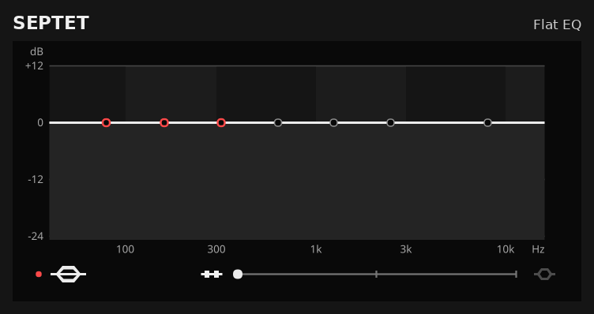

# Septet

Septet is a seven-band stereo graphic EQ for an OP-XY instrument track. It runs once on the track sum and follows the M3 filter switch. Septet 0.1.2 targets OP-XY OS 1.2.1 with Open-XY API 1.17.

*Rendered from Septet’s M3 artwork and response code.*

## Install

1. In **TE Builder**, choose **File → Import Machine ZIP…** and open **Septet-0.1.2.zip**.
2. Queue **Septet 0.1.2** in **Available**, then build and stage for your XY.
3. On the XY, choose **septet** in the instrument filter picker and open M3.

See [Building from source](docs/BUILDING.md) for the standalone Open-XY build and the exact SDK revision.

## Controls

| M3 control | Main | Second bank |
|---|---|---|
| K1 turn | 80 Hz low shelf | 640 Hz bell |
| K2 turn | 160 Hz bell | 1.25 kHz bell |
| K3 turn | 320 Hz bell | 2.5 kHz bell |
| K4 turn | Mode sweep | 8 kHz high shelf |
| K2 press | Open second bank | Return to main |
| K3 press | Reset all seven bands to 0 dB | Reset all seven bands to 0 dB |
| K4 press | Cycle mode | Stock behavior |

All bands start at 0 dB and cover ±12 dB. Main controls use the stock four filter parameter words for sequencing and Morph. The four upper gains and mode are stored per track and pattern in the project's .oxy companion. Keep the companion with the .xy file.

For ordinary stereo EQ, use Series / Parallel with main-bank K4 fully left (the default). Each band at 0 dB drops out of the EQ. Turn K4 right to blend from a cascade to independent corrections. Correction Solo removes progressively more of the dry signal. At full sweep, a flat EQ in Correction Solo produces silence. Mid / Side runs from mid only through full stereo to side only. The white curve shows mid on the left half of the sweep and side on the right. The thinner gray curve shows the other channel. At center the responses coincide.

The outer bands use first-order shelves. The five bells use a three-product recurrence. Series and Parallel endpoints skip the routing multiply, and settled controls skip ramp work. The display response is generated from the DSP coefficients.

The main and second bank share the M3 display. Each dot shows its band’s gain from −12 to +12 dB. A hollow dot on the horizontal dotted line marks exactly 0 dB. Filled dots show cuts and boosts. Red outlines mark the bands assigned to the current bank. The response curve includes the combined effect of the bands and routing. The lower-left icon identifies the routing mode. A red dot immediately to its left indicates that K4 controls the sweep. Switching to the second bank hides the dot and assigns K4 to the 8 kHz shelf. The slider and its proximity-lit endpoint symbols show the sweep in either bank. The second bank dims its handle. The graph uses closed SVG contours and updates when the displayed gain or sweep changes.

## Compatibility

The repository and ZIP include the Septet integration and shared Morph/Trine SDK patches. Morph and Trine themselves are optional machines. Morph gui2d22 can address the four main filter parameters and displays Septet with its generic filter HUD. Septet supports layouts with Grainfield, including ones where Grainfield already occupies effect slot 8.

Septet 0.1.2 adds a stereo track insert for drum filter selection. Its seven-band EQ still runs once on the track sum. See [LICENSE](LICENSE) and [component licenses](LICENSES/) for redistribution terms.
